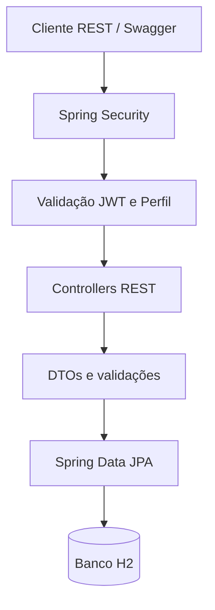
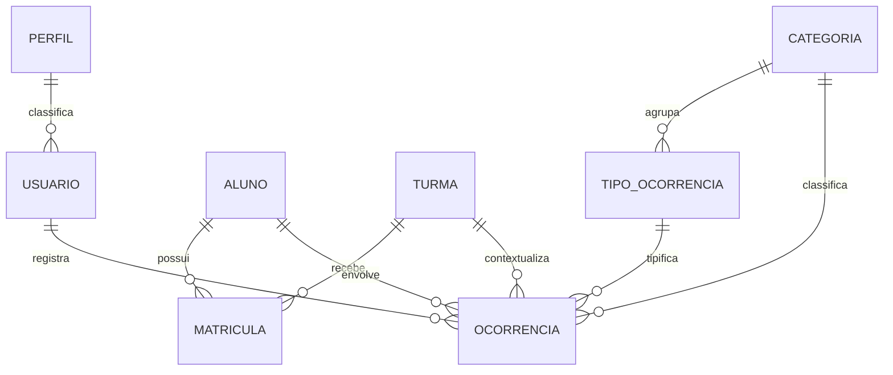

# Relatório Técnico Final — Checkpoint 6
## Sistema para Gestão de Ocorrências Escolares

**Disciplina:** Arquitetura SOA e Web Services  
**Professor:** Carlos Eduardo Machado de Oliveira  
**Grupo:** Vinicius Henrique, Enzo Dias, Gustavo Pierre, Gabriel Belo e Laura Souza.

## 1. Introdução
O projeto implementa uma API REST para apoiar o registro, consulta e acompanhamento de ocorrências escolares. A solução separa responsabilidades entre camada HTTP, segurança, persistência e modelo de domínio, permitindo que diferentes clientes consumam os serviços.

## 2. Objetivo
Disponibilizar serviços para autenticação e autorização por perfil, manutenção de alunos e turmas, matrícula de alunos em diferentes turmas ao longo dos períodos letivos, gerenciamento de categorias e tipos, registro de ocorrências, consultas, histórico e indicadores gerenciais.

## 3. Tecnologias
- Java 17
- Spring Boot 3.3.5
- Spring Web para endpoints REST
- Spring Data JPA e Hibernate para persistência
- Spring Security e JWT para autenticação/autorização
- Bean Validation para validação dos dados
- H2 em modo arquivo para execução local
- Springdoc OpenAPI / Swagger para documentação interativa
- Maven para gerenciamento de dependências e build

## 4. Arquitetura da solução
A arquitetura segue uma separação por responsabilidades:
1. Cliente REST ou interface web envia requisições HTTP.
2. Controllers recebem as requisições e retornam DTOs, evitando expor entidades JPA diretamente.
3. Spring Security valida o token JWT e aplica regras de autorização por perfil.
4. Repositórios Spring Data JPA realizam operações de persistência.
5. Hibernate mapeia as entidades para as tabelas relacionais.



## 5. Modelo de dados
- Usuário possui um perfil de acesso.
- Aluno e Turma possuem relacionamento muitos-para-muitos materializado pela entidade Matrícula.
- Matrícula armazena data de entrada, status e data de encerramento, preservando o histórico.
- Ocorrência possui referências obrigatórias para turma, aluno, professor responsável, categoria e tipo.
- Tipo de ocorrência pertence a uma categoria.



## 6. Segurança e autorização
O login valida a senha armazenada com BCrypt e emite um token JWT com identificação e perfil. As requisições protegidas devem enviar `Authorization: Bearer <token>`. A aplicação não mantém sessão HTTP.

| Perfil | Permissões |
|---|---|
| Professor | Registrar ocorrências; consultar ocorrências de todos os professores; alterar/excluir somente as próprias |
| Analista de Qualidade | Consultar ocorrências e relatórios |
| Coordenador | Consultar ocorrências, dashboard e relatórios |
| Administrativo | Gerenciar alunos, turmas, matrículas, categorias, tipos e usuários |

## 7. Regras de negócio implementadas
- Não é possível registrar ocorrência para aluno sem matrícula ativa na turma selecionada.
- O tipo de ocorrência deve pertencer à categoria informada.
- Registros inativos não podem ser usados em novas ocorrências.
- O professor somente altera ou exclui ocorrências de sua autoria.
- Matrículas encerradas são preservadas para histórico.
- Filtros por aluno, turma, categoria, tipo e intervalo de datas estão disponíveis.
- O dashboard calcula totais por categoria, turma e mês, além de ranking de alunos reincidentes.

## 8. Endpoints principais
A relação completa, exemplos de JSON e perfis responsáveis está no README. A documentação interativa é publicada em `/swagger-ui/index.html`.

## 9. Persistência
O banco H2 está configurado em modo arquivo para manter dados após reiniciar a aplicação. O mapeamento JPA cria e atualiza as tabelas no início da execução. Para implantação real, devem ser configuradas credenciais e banco de produção, além de substituir a chave JWT de demonstração.

## 10. Validação e execução
O projeto inclui teste de inicialização do contexto Spring Boot. Os comandos previstos para validação local são:

```bash
mvn clean test
mvn spring-boot:run
```

O ambiente de geração deste pacote não possui Maven instalado; portanto, não foi possível executar o ciclo Maven neste ambiente. A validação final de compilação e execução deve ser realizada em uma máquina com JDK 17+ e Maven 3.8+.

## 11. Limites e melhorias futuras
O escopo implementa API REST e persistência. A foto do aluno é armazenada como URL, sem serviço de upload binário. Os relatórios são retornados em JSON, sem exportação PDF/Excel. A interface HTML/CSS/JS que veio no ZIP original foi mantida como protótipo de referência separado, pois ela utiliza contratos e endereço de uma API anterior; a integração visual completa exige adaptar suas chamadas para os endpoints documentados neste projeto.

## 12. Conclusão
A solução estrutura os principais serviços necessários ao gerenciamento de ocorrências escolares, com autenticação, autorização por perfil, persistência relacional e regras de integridade entre aluno, turma, categoria e tipo de ocorrência. A API pode ser consumida por Swagger, Postman ou por uma aplicação web cliente.
